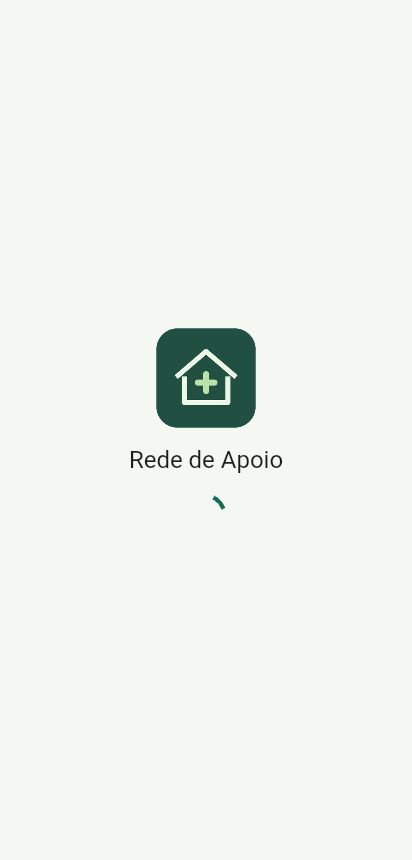
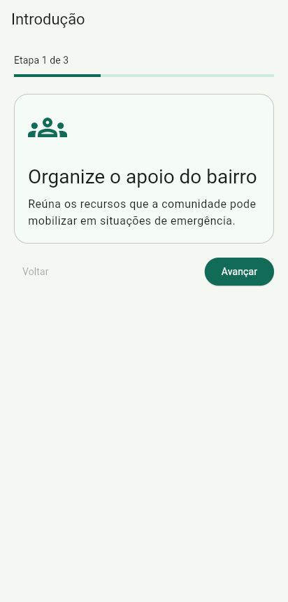
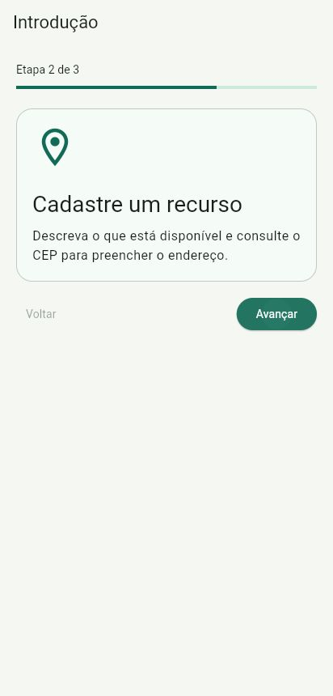
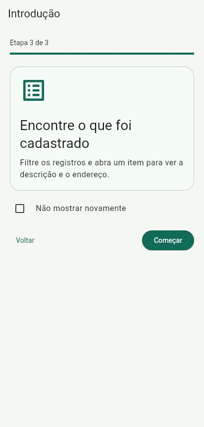
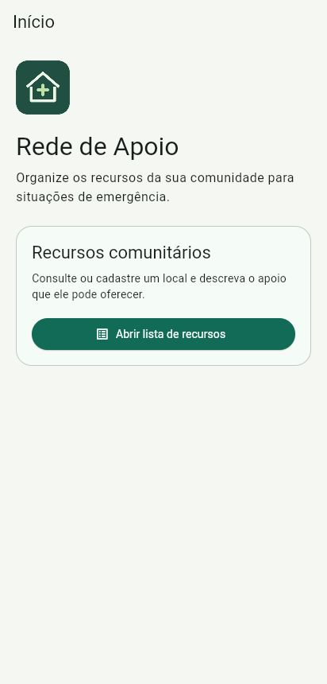
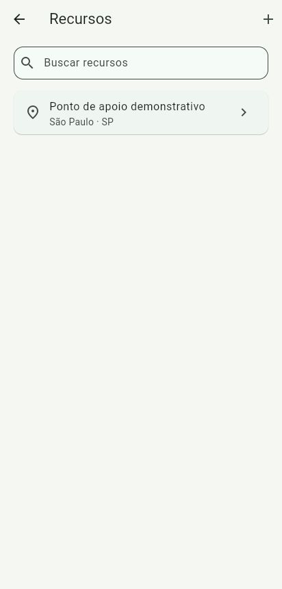
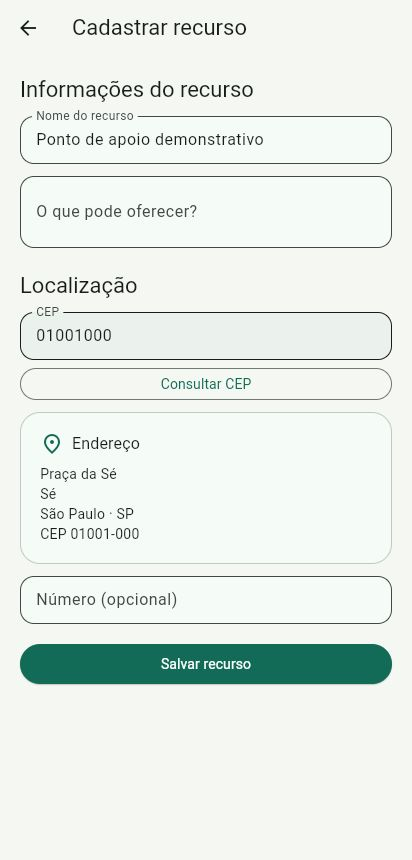
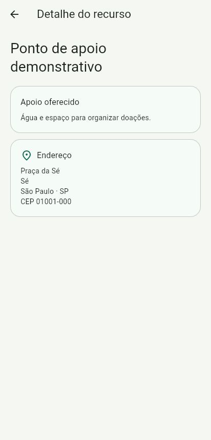

# Rede de Apoio

Aplicativo em Flutter e Dart para o tema 14 da Global Solution CitizenTech, sobre segurança, comunicação e coordenação de recursos comunitários em situações de emergência.

## Solução

O app permite manter um cadastro local dos recursos que uma comunidade pode mobilizar. Cada registro tem nome, descrição do apoio oferecido e endereço consultado pelo CEP. A pessoa pode cadastrar um recurso, buscar os registros pelo nome, descrição ou cidade e tocar em um item para abrir seus detalhes. Os registros são inseridos pelo usuário e ficam no dispositivo.

A proposta se relaciona com o **ODS 11 — Cidades e comunidades sustentáveis**. Organizar previamente os locais e os recursos disponíveis no bairro ajuda a comunidade a se preparar para emergências.

## Fluxo de telas

1. **Splash** mostra a marca e consulta a preferência de introdução.
2. **Introdução** tem três etapas, controles para avançar e voltar e a opção “Não mostrar novamente”.
3. **Início** apresenta o propósito do app e abre a lista.
4. **Recursos** lista e filtra os registros salvos e permite abrir o cadastro.
5. **Cadastrar recurso** valida os campos, consulta o CEP e salva o registro.
6. **Detalhe do recurso** recebe o item selecionado e mostra o apoio oferecido e o endereço.

Na primeira abertura, a Splash leva à introdução. Ao concluir com “Não mostrar novamente” marcado, o app abre diretamente no Início da próxima vez. Com a opção desmarcada, a introdução continua aparecendo. Ao salvar um cadastro, o app volta à lista e recarrega os registros.

## Prints das telas

Capturas do app executado no Chrome com largura de celular. O registro exibido foi cadastrado para demonstrar o fluxo.

| Splash | Introdução 1 | Introdução 2 | Introdução 3 |
| --- | --- | --- | --- |
|  |  |  |  |

| Início | Recursos | Cadastro | Detalhe |
| --- | --- | --- | --- |
|  |  |  |  |

[Cadastro com CEP inexistente e opção de tentar novamente](docs/prints/05-cadastro-erro.jpg)

## API utilizada

O cadastro usa `http` para fazer `GET https://viacep.com.br/ws/{cep}/json/`. O serviço valida os oito dígitos, trata falhas de conexão e converte o JSON em `Endereco`. O formulário exibe os estados inicial, carregando, sucesso e erro. Em caso de erro, oferece nova tentativa. [Documentação do ViaCEP](https://viacep.com.br/)

## Arquitetura

| Pasta em `lib/` | Responsabilidade |
| --- | --- |
| `models/` | Modelos de endereço e recurso, conversão de JSON e filtro. |
| `services/` | Requisição e tratamento de erros do ViaCEP. |
| `data/` | Preferência de introdução e registros locais via `SharedPreferencesAsync`. |
| `screens/` | Navegação, formulários e estado da interface com `setState`. |
| `widgets/` | Marca, painel, conteúdo centralizado e resumo do endereço reutilizados nas telas. |

## Executar

Com Flutter 3.41 e Dart 3.11.5 ou uma versão compatível, extraia o projeto e rode na pasta que contém `pubspec.yaml`.

```sh
flutter pub get
flutter run -d chrome
```

Para rodar no Android com Flutter 3.41.7, prepare a plataforma Android 36 e o NDK 28.2.13676358 no SDK Manager. Conecte um dispositivo ou inicie um emulador. Execute `flutter devices` para obter o ID e use `flutter run -d ID_DO_DISPOSITIVO`.

## Integrantes

- Luis Carlos de Oliveira (RM554803)
- Guilhermo Spera Payosin (RM556356)
- Caroline Rocha (RM556708)
